
<picture><source media="(prefers-color-scheme: dark)" srcset="images/masthead-dark.svg"></picture>

New York · [gzl.dev](https://gzl.dev) · [gio@gi-os.com](mailto:gio@gi-os.com)

<picture><source media="(prefers-color-scheme: dark)" srcset="images/head-iphone-dark.svg">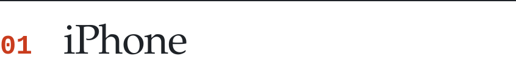</picture>

<a href="https://github.com/gi-os/XA"><picture><source media="(prefers-color-scheme: dark)" srcset="images/card-xa-dark.svg">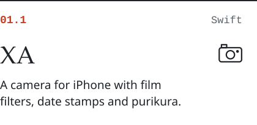</picture></a>
<a href="https://github.com/gi-os/NDPass"><picture><source media="(prefers-color-scheme: dark)" srcset="images/card-ndpass-dark.svg">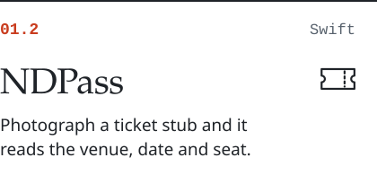</picture></a>
<a href="https://github.com/gi-os/m-cas"><picture><source media="(prefers-color-scheme: dark)" srcset="images/card-m-cas-dark.svg">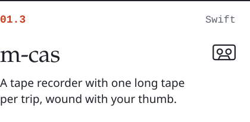</picture></a>
<a href="https://github.com/gi-os/Bunko"><picture><source media="(prefers-color-scheme: dark)" srcset="images/card-bunko-dark.svg">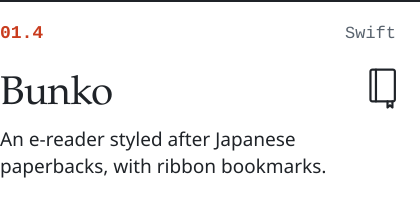</picture></a>
<a href="https://github.com/gi-os/TapeDelay"><picture><source media="(prefers-color-scheme: dark)" srcset="images/card-tapedelay-dark.svg">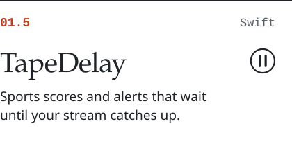</picture></a>
<a href="https://github.com/gi-os/BlockBliss"><picture><source media="(prefers-color-scheme: dark)" srcset="images/card-blockbliss-dark.svg">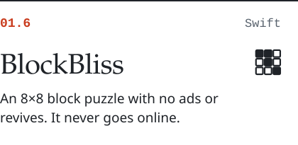</picture></a>
<a href="https://github.com/gi-os/SupernoteIOS"><picture><source media="(prefers-color-scheme: dark)" srcset="images/card-supernoteios-dark.svg">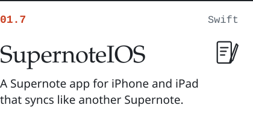</picture></a>
<a href="https://github.com/gi-os?tab=repositories&amp;language=swift"><picture><source media="(prefers-color-scheme: dark)" srcset="images/card-all-swift-projects-dark.svg">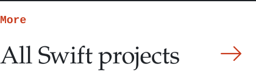</picture></a>

<picture><source media="(prefers-color-scheme: dark)" srcset="images/head-shops-dark.svg"></picture>

I built these at LR Paris. Every shop on [lrparisstore.com](https://lrparisstore.com) runs on them, each in its own container on one shared server.

<a href="https://lrparisstore.com"><picture><source media="(prefers-color-scheme: dark)" srcset="images/card-shuttle-dark.svg">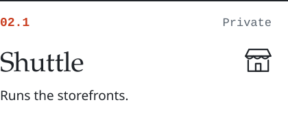</picture></a>
<a href="https://lrparisstore.com"><picture><source media="(prefers-color-scheme: dark)" srcset="images/card-launchpad-dark.svg">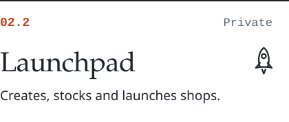</picture></a>

<picture><source media="(prefers-color-scheme: dark)" srcset="images/head-light-phone-dark.svg">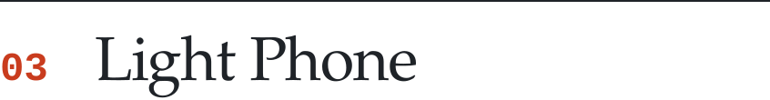</picture>

Apps for a phone whose home screen is a list of words.

<picture><source media="(prefers-color-scheme: dark)" srcset="images/words-dark.svg">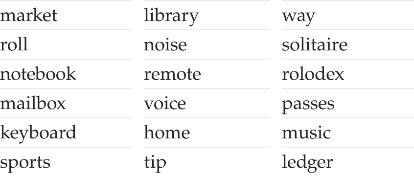</picture>

<a href="https://github.com/gi-os/BrightMarket"><picture><source media="(prefers-color-scheme: dark)" srcset="images/card-brightmarket-dark.svg">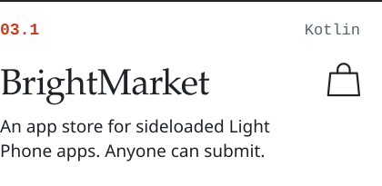</picture></a>
<a href="https://github.com/gi-os/Roll"><picture><source media="(prefers-color-scheme: dark)" srcset="images/card-roll-dark.svg">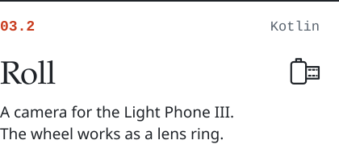</picture></a>
<a href="https://github.com/gi-os/BrightControl"><picture><source media="(prefers-color-scheme: dark)" srcset="images/card-brightcontrol-dark.svg">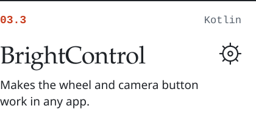</picture></a>
<a href="https://github.com/gi-os/BrightKeyboard"><picture><source media="(prefers-color-scheme: dark)" srcset="images/card-brightkeyboard-dark.svg">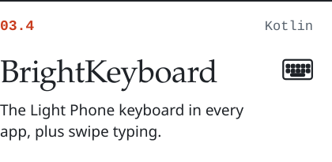</picture></a>
<a href="https://github.com/gi-os/BrightMailbox"><picture><source media="(prefers-color-scheme: dark)" srcset="images/card-brightmailbox-dark.svg">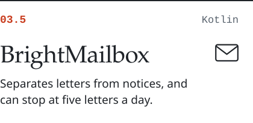</picture></a>
<a href="https://github.com/gi-os?tab=repositories&amp;q=Bright"><picture><source media="(prefers-color-scheme: dark)" srcset="images/card-all-bright-apps-dark.svg">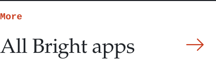</picture></a>

To list an app in BrightMarket, add it to [brightmarket-index](https://github.com/gi-os/brightmarket-index).

<picture><source media="(prefers-color-scheme: dark)" srcset="images/head-systems-dark.svg"></picture>

<picture><source media="(prefers-color-scheme: dark)" srcset="images/card-gi-os-dark.svg">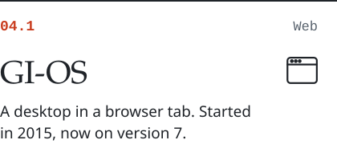</picture>
<a href="https://github.com/gi-os/PassportOS"><picture><source media="(prefers-color-scheme: dark)" srcset="images/card-passportos-dark.svg">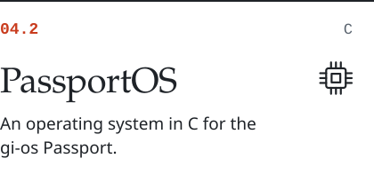</picture></a>
<a href="https://github.com/gi-os/June4"><picture><source media="(prefers-color-scheme: dark)" srcset="images/card-june-dark.svg">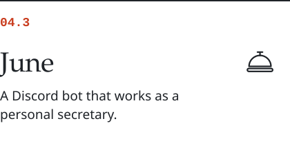</picture></a>
<a href="https://github.com/gi-os?tab=repositories"><picture><source media="(prefers-color-scheme: dark)" srcset="images/card-all-repositories-dark.svg">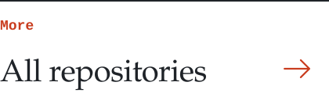</picture></a>

Most of this is Swift, Kotlin or Node, with SQLite, React, Docker, nginx and bash.

<picture><source media="(prefers-color-scheme: dark)" srcset="images/head-sponsors-dark.svg"></picture>

<!-- Sponsors -->

Thank you, <a href="https://github.com/lobstermaninurhouse-dev">@lobstermaninurhouse-dev</a>, and everyone who sponsors privately. Sponsorships help keep the Bright apps free.

<!-- /Sponsors -->

<a href="https://github.com/sponsors/gi-os"><picture><source media="(prefers-color-scheme: dark)" srcset="images/button-sponsor-dark.svg"></picture></a>

<picture><source media="(prefers-color-scheme: dark)" srcset="images/head-guestbook-dark.svg"></picture>

<a href="https://github.com/gi-os/gi-os/issues/1#issuecomment-new"><picture><source media="(prefers-color-scheme: dark)" srcset="images/button-guestbook-dark.svg"></picture></a>

<!-- Guestbook -->
| Name | Date | Message |
|---|---|---|
| <a href="https://github.com/Ameryth"> Ameryth</a> | 2026-10-21 | Signed. |
<!-- /Guestbook -->
