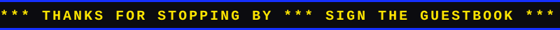

<!-- Retro terminal header -->
<div align="center">
  
</div>

<p align="center">
Small software, end to end: the schema, the API, the interface, the container.<br />
<a href="https://gzl.dev">gzl.dev</a> · <a href="mailto:gio@gi-os.com">gio@gi-os.com</a>
</p>

<!-- Menu: like an old terminal service index -->
<table width="100%">
<tr>
<td align="center" width="33%"><a href="#iphone"><strong>1 · IPHONE</strong></a></td>
<td align="center" width="33%"><a href="#shops"><strong>2 · SHOPS</strong></a></td>
<td align="center" width="33%"><a href="#light-phone"><strong>3 · LIGHT PHONE</strong></a></td>
</tr>
</table>

### iPhone

| | |
|---|---|
| [**XA**](https://github.com/gi-os/XA) | a camera that's fun to use: filters, date backs, purikura |
| [**NDPass**](https://github.com/gi-os/NDPass) | collects your movie ticket stubs, with a little help from AI |
| [**m-cas**](https://github.com/gi-os/m-cas) | a tape recorder: one continuous tape per trip, wound with your thumb |
| [**BlockBliss**](https://github.com/gi-os/BlockBliss) | an honest 8×8 block puzzle, none of the manipulation |
| [**SupernoteIOS**](https://github.com/gi-os/SupernoteIOS) | a Supernote client for iPhone and iPad that syncs like a real device |

### Shops

[**Shuttle**](https://github.com/LR-Paris/Shuttle) runs the storefronts.
[**Launchpad**](https://github.com/LR-Paris/Launchpad) creates, stocks and launches them.
One container per shop, one droplet for all of it. The shops on lrparisstore.com run here.

[**BrightMarket**](https://github.com/gi-os/BrightMarket) is a shop of a different kind: an app store for the Light Phone III,
with an [index](https://github.com/gi-os/brightmarket-index) anyone can submit to.

### Light Phone

Apps for a phone whose home screen is a list of words.

| | |
|---|---|
| [**Roll**](https://github.com/gi-os/Roll) | a camera that's fun to use, the original XA |
| [**BrightControl**](https://github.com/gi-os/BrightControl) | the brightness wheel and camera button, working inside any app |
| [**BrightKeyboard**](https://github.com/gi-os/BrightKeyboard) | the Light Phone keyboard, for any app |
| [**BrightMailbox**](https://github.com/gi-os/BrightMailbox) | email: letters from people, notices from machines, five a day |

[All of them →](https://github.com/gi-os?tab=repositories&q=Bright)

### Systems

```
GI-OS        a desktop in a browser tab · since 2015 · v7
PASSPORTOS   C, for the Passport device
JUNE         a virtual secretary, before the assistants
```

```
STACK  swift · kotlin · node · sqlite · react · docker · nginx · bash
```

### Sponsors

<!-- Sponsors -->
<p align="center">
<a href="https://github.com/lobstermaninurhouse-dev"></a>
</p>

<p align="center">Thank you, <a href="https://github.com/lobstermaninurhouse-dev">@lobstermaninurhouse-dev</a>, and everyone who sponsors quietly.<br />Every Bright app is free because of you. <a href="https://github.com/sponsors/gi-os">Sponsor →</a></p>
<!-- /Sponsors -->

### Guestbook

<div align="center">
  <a href="https://github.com/gi-os/gi-os/issues/1#issuecomment-new">
    
  </a>
</div>

<!-- Guestbook -->
| Name | Date | Message |
|---|---|---|
| <a href="https://github.com/Ameryth"> Ameryth</a> | 2026-10-21 | Signed. |
<!-- /Guestbook -->

<br />

<div align="center">
  
</div>
